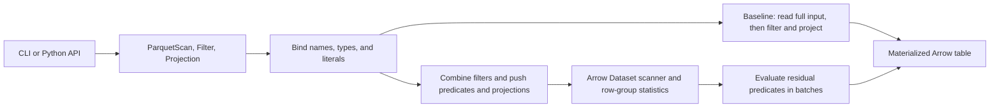

# Parquet Query Engine

A rule-based local Parquet query engine for learning how predicate and projection pushdown work. It builds a logical plan, validates the schema, and runs either a materializing baseline or an Arrow-backed optimized scan. This implementation was reconstructed from the original project architecture.

## Quick start

Use Python 3.11 or newer. Run the following from the repository root.

```sh
python3 -m venv .venv
source .venv/bin/activate
python -m pip install -r requirements.txt
python examples/make_sample.py
python main.py examples/sample.parquet --columns lap corner --where speed_kph '>' 140 --row-groups
```

On Windows PowerShell, activate the environment with `.venv\Scripts\Activate.ps1`. The generated example is synthetic. The query returns lap 2 and lap 3 at corner T2. The optimized scan reports two of three candidate row groups. Add `--no-optimize` to run the baseline and compare the plan and rows. Repeat `--where` to combine filters with AND. Comparison values are JSON, so a text filter is written as `--where corner '==' '"T2"'`. The `--limit` flag limits displayed rows.

### Before and after optimization

For the quick-start query, the CLI emits these plans.

```text
Original plan
Projection(lap, corner)
  Filter(speed_kph > 140)
    ParquetScan(sample.parquet, columns=[*], predicate=none)

Optimized plan
ParquetScan(sample.parquet, columns=[lap, corner], predicate=speed_kph > 140)
```

The optimized scan can use `speed_kph` for filtering while returning just `lap` and `corner`. Both plans return the same two rows in the same order.

### Python API

```python
from optimizer import optimize
from parquet import ParquetScan
from plan import Comparison, Filter, Projection

query = Projection(
    Filter(ParquetScan("examples/sample.parquet"), Comparison("speed_kph", ">", 140)),
    ("lap", "corner"),
)
scan = optimize(query)
print(scan.explain())
print(scan.execute().to_pylist())
```

## Architecture



- `plan.py` defines immutable operators, comparisons, and conjunctions. `schema.py` binds literals to the physical column types and preserves projected field order, nullability, and metadata.
- `optimizer.py` validates the original plan before applying fixed-point rewrites. A filter can move through a projection only if the projection retains its referenced columns. A filter pushed into a scan can use columns omitted from the final result.
- `parquet.py` delegates statistics-based pruning and column reads to Arrow Dataset. A floating-point `!=` predicate is evaluated after decoding because Parquet min/max statistics can omit NaN. Other safe conjuncts can still prune row groups. Residual columns are dropped before retaining the result batches.

### Optimizer rules and execution ownership

| Rule | Implemented here |
| --- | --- |
| Schema validation | Resolve column references and bind literals before accepting a rewrite. Validate output names, types, order, and metadata after rewriting. |
| Filter combination | Replace adjacent filters with one conjunction. |
| Predicate pushdown | Move a filter below an eligible projection and into the scan. Split floating-point inequality into a residual filter when statistics may omit NaN. |
| Projection pushdown | Collapse nested projections and pass the required output columns into the scan. Retain residual filter columns only through evaluation. |

PyArrow provides Parquet metadata and page decoding, row-group pruning, physical column projection, expression evaluation, and the Arrow result table. The integration tests compare optimized and baseline values, row order, and schema metadata, including nulls, NaN, and empty results.

### Comparison rules

| Arrow column type | Supported literals |
| --- | --- |
| Integer | In-range JSON integer |
| Float32 or Float64 | Finite JSON number, bound to the column's precision. Integer literals must be exactly representable. |
| String or large string | JSON string |
| Boolean | JSON boolean with `==` or `!=` |

Unsupported column types and incompatible literals are rejected before execution. A comparison with a null field drops that row. NaN is distinct from null and compares unequal to finite numbers. Files without usable statistics may require reading every row group. Candidate row groups are metadata estimates, not measured I/O.

## Tests and reproducible benchmark

```sh
python -m pip install -r requirements-dev.txt
python -m pytest -q -rs
python -m benchmarks.run --output docs/benchmark-results.json
```

All 50 tests passed locally with PyArrow 26.0.1 and Python 3.12 on macOS, including every integration case. CI is prepared for Linux, macOS, and Windows with Python 3.11 and 3.12. It runs the tests, a benchmark smoke check on Linux, and a Gitleaks job. [Hosted CI runs](https://github.com/abdulibrahim7/parquet-query-engine/actions)

The measured fixture had 400,000 synthetic rows, 20 row groups, and 16 columns. Each query returned one column. The harness verified identical results and schema metadata before timing five trials per mode in fresh worker processes. These are medians for this machine and fixture.

| Workload | Candidate groups, baseline → optimized | Time, baseline → optimized | Arrow peak, baseline → optimized | Process RSS peak, baseline → optimized |
| --- | ---: | ---: | ---: | ---: |
| Selective, 40,000 output rows | 20 → 2 | 28.75 → 1.08 ms | 93.07 → 1.18 MiB | 163.91 → 61.80 MiB |
| Broad, 400,000 output rows | 20 → 20 | 31.20 → 2.58 ms | 96.17 → 6.38 MiB | 208.17 → 67.81 MiB |

See the [benchmark method](docs/benchmarks.md) and [raw trials](docs/benchmark-results.json).

## Scope

One trusted local Parquet file with flat columns. The engine supports comparisons, conjunctions, filters, and projections. It materializes the final result in memory. The baseline intentionally reads the full input table. There is no SQL parser, join or aggregation engine, distributed execution, or streaming result interface.

[Arrow row-group fragment API](https://arrow.apache.org/docs/python/generated/pyarrow.dataset.ParquetFileFragment.html) · [Arrow record batch API](https://arrow.apache.org/docs/python/generated/pyarrow.RecordBatch.html)
